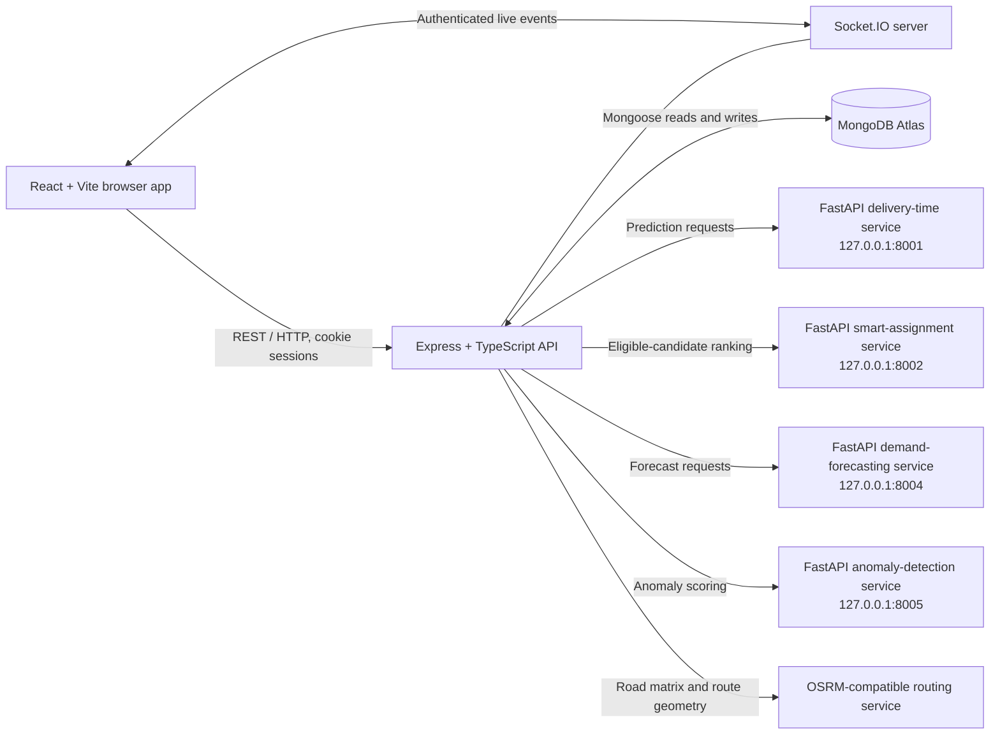

# SWERV

### Fleet operations, from dispatch to proof of delivery.

SWERV is a fleet operations platform for managing agents, coordinating deliveries, and keeping operational work visible in one web application. It combines a React dashboard, an authenticated Express API, MongoDB persistence, real-time updates, and separate Python services for machine-learning prototypes.

[](https://react.dev/)
[](https://www.typescriptlang.org/)
[](https://vite.dev/)
[](https://nodejs.org/)
[](https://www.mongodb.com/)
[](https://socket.io/)
[](https://fastapi.tiangolo.com/)

## Project overview

SWERV brings fleet workflows together: administrators and operators manage agents and dispatch requests, while agents use a separate portal for deliveries and attendance. The API enforces role checks, stores operational data in MongoDB, and emits selected updates through Socket.IO. Python FastAPI services provide delivery-time, agent-assignment, demand-forecasting, and anomaly-detection prototypes.

The interface follows SWERV's dark, Carbon Coral visual direction. The prediction services and bundled models are prototype components: model artifacts described as synthetic-trained have **not** been validated for accuracy on real SWERV operations.

## Key highlights

- Separate authenticated experiences for Admins, Operators, and delivery Agents.
- Dispatch workflows connected to agent capacity, delivery tracking, and proof-of-delivery records.
- Live fleet and notification updates delivered through authenticated Socket.IO rooms.
- Agent check-in and check-out with attendance dates based on the IST calendar.
- Optional FastAPI services with model-availability checks instead of fabricated prediction values.
- Synthetic data and model artifacts kept separate from real operational records.

## Features and modules

| Module | What it does | Value in fleet operations |
| --- | --- | --- |
| Authentication and roles | Provides user and agent login flows, session cookies, and role-based API access. The first public user registration becomes Admin; later public registrations become Operators. | Keeps administrative work and agent workflows scoped to the appropriate account. |
| Agent Management | Creates and maintains agent profiles, vehicle and capacity details, capabilities, operational status, and activity history. Admins manage records; Admins and Operators can perform permitted status changes. | Helps dispatchers find agents who are active and eligible for a request. |
| Dispatch Management | Creates and updates dispatch requests, manages assignment and lifecycle status, and exposes dispatch analytics and customer tracking links. | Keeps work assignment and delivery progress in a shared workflow. |
| Delivery Time Prediction | Calls a FastAPI prediction endpoint using dispatch information available at prediction time. The bundled model is synthetic-trained; the workspace also contains a separate real-data extraction and training workflow. | Offers an experimental duration estimate without treating it as a guaranteed ETA. |
| Smart Agent Assignment | Applies backend eligibility checks and asks a separate ML service to rank eligible candidates by predicted delivery duration. Recommendations do not assign an agent by themselves. | Gives dispatchers a ranked shortlist while leaving assignment decisions in the existing workflow. |
| AI Demand Forecasting | Provides an Admin-only forecasting workflow backed by a separate model service. The included hourly-demand model is trained on generated synthetic data. | Demonstrates a forecast workflow; synthetic results are not evidence of real demand accuracy. |
| AI Anomaly Detection | Combines explainable operational checks with synthetic-trained anomaly scoring. Admins can review alerts; real and synthetic-demo data are kept separate. | Surfaces records for human review without automatically changing dispatch or agent state. |
| Proof of Delivery | Agents submit delivery evidence, customer verification, a signature, and location information or an explicit location-unavailable reason. Admins have read-only review routes. | Creates a structured delivery record and supporting evidence. No email or SMS OTP provider is configured in this repository. |
| Real-Time Fleet Tracking | Accepts agent location updates, provides current and historical location APIs, and sends selected fleet and dispatch events over Socket.IO. Token-based customer tracking is also available. | Gives operations users timely visibility into fleet activity and delivery progress. |
| Route Optimization | Uses an OSRM-compatible routing service to compare a baseline stop order with a nearest-next-stop plan for assigned deliveries. Pickup-before-delivery order is preserved. | Helps organize a driver's existing delivery sequence using provider road estimates. |
| Notification Management | Persists user- and agent-scoped notifications for supported operational events, with list, unread-count, and read operations plus new-notification events. | Keeps the relevant user informed without exposing another recipient's notifications. |
| Agent Attendance Management | Records agent check-in and check-out, keeps the attendance date tied to the IST day of check-in, and provides history and an Admin/Operator filtered view. Timestamps are stored in UTC. | Makes daily agent attendance available to the agent and operations staff. |

### ML prototype limitations

Bundled delivery-time, smart-assignment, demand-forecasting, and anomaly-detection models are identified as synthetic-trained. Their evaluation measures behavior against generated data, not real fleet outcomes. Do not interpret synthetic metrics as production accuracy. The delivery-time workspace also includes a read-only MongoDB data extraction path and requires at least 200 valid labeled deliveries before its real-data training pipeline fits a model; this threshold is not a guarantee of model reliability.

## Technology stack

| Area | Technologies |
| --- | --- |
| Web application | React 19, TypeScript, Vite, React Router, Tailwind CSS, Leaflet |
| Backend API | Node.js, Express 5, TypeScript, Mongoose, Zod |
| Persistence | MongoDB / MongoDB Atlas |
| Live communication | Socket.IO |
| ML and data workspaces | Python, FastAPI, Uvicorn, pandas, NumPy, scikit-learn |
| Routing | OSRM-compatible routing API; the example configuration uses the public OSRM demo service |
| Verification | Vitest, Supertest, `node:test`, TypeScript builds, Oxlint, Python `unittest` |

## System architecture



The Python services are separate processes; the browser communicates with the Express API rather than calling those model endpoints directly. The backend and Socket.IO server share the same HTTP server. The routing provider is external and configurable.

## Project folder structure

```text
SWERV/
├── backend/
│   ├── src/
│   │   ├── config/          # Environment and service configuration
│   │   ├── controllers/     # HTTP request handlers
│   │   ├── middleware/      # Authentication, authorization, errors
│   │   ├── models/          # Mongoose schemas and indexes
│   │   ├── realtime/        # Socket.IO server
│   │   ├── routes/          # Registered API route groups
│   │   ├── services/        # Operational and integration logic
│   │   ├── types/
│   │   └── utils/
│   ├── test/
│   ├── .env.example
│   └── package.json
├── frontend/
│   ├── public/
│   ├── src/
│   │   ├── assets/
│   │   ├── components/
│   │   ├── context/
│   │   ├── hooks/
│   │   ├── lib/
│   │   ├── pages/
│   │   └── types/
│   ├── test/
│   └── package.json
├── ml/
│   ├── anomaly_detection/
│   ├── delivery_time_prediction/
│   ├── demand_forecasting/
│   └── smart_agent_assignment/
│       # Each workspace contains its own src/, tests/, README, and requirements.
├── .gitattributes          # Git LFS rules for .joblib model artifacts
├── .gitignore
└── README.md
```

The ML workspaces include bundled synthetic model artifacts under their `models/` folders. Generated datasets, virtual environments, caches, build output, and private uploads are intentionally omitted from this tree.

## Screenshots and demo

No genuine product screenshots or hosted demo URL are currently included in the repository. The existing frontend image is an abstract graphic, not a screenshot, so it is not presented as product UI.

Screenshots can be added here when reviewed images are available:

- **Operations dashboard:** add a genuine dashboard capture.
- **Live fleet and dispatch workflow:** add a genuine fleet view.
- **Agent portal and attendance:** add a genuine agent view.

## Installation and local setup

### Prerequisites

- Windows 10/11 with PowerShell.
- Node.js 20.19+ or 22.12+, and npm.
- Python 3.10+ and `pip` for the optional ML services.
- Git and Git LFS. The `.joblib` model artifacts are stored with Git LFS.
- A MongoDB Atlas deployment or another transaction-capable MongoDB replica set. SWERV uses MongoDB transactions for some workflows.

### 1. Clone the repository

Install Git LFS, then clone and fetch the model artifacts:

```powershell
git lfs install
git clone https://github.com/ShivaniiYadav28/SWERV.git
cd SWERV
git lfs pull
```

### 2. Configure the backend and database

Create a local backend environment file only if one does not already exist. Then edit it with your own MongoDB connection string and independently generated secrets:

```powershell
if (-not (Test-Path backend\.env)) {
  Copy-Item backend\.env.example backend\.env
}
```

Set `MONGO_URI`, `JWT_SECRET`, and `AGENT_JWT_SECRET` in `backend\.env`. Both JWT secrets must be independent random values of at least 32 characters. Configure MongoDB for a replica set / transaction-capable deployment. Do not commit the resulting `.env` file or put real values in `.env.example`.

The first successful public user registration is assigned the Admin role; subsequent public registrations are Operators. Register the intended administrator first and protect that account.

### 3. Install and start the backend

In a PowerShell terminal:

```powershell
cd backend
npm ci
npm run dev
```

The API listens on `http://localhost:5000` by default. Check `http://localhost:5000/api/health` after the database connection succeeds.

### 4. Install and start the frontend

In a second terminal from the repository root:

```powershell
cd frontend
npm ci
npm run dev
```

Open <http://localhost:5173>. The frontend uses `http://localhost:5000` as its default API and Socket.IO origin. If your backend is at a different origin, set the optional `VITE_API_URL` before starting Vite.

### 5. Set up optional Python ML services

Each ML service has its own `requirements.txt` and Python workspace. From the repository root, create and activate a virtual environment in the service directory you intend to run, then install that workspace's requirements. For example, for Delivery Time Prediction:

```powershell
cd ml\delivery_time_prediction
python -m venv .venv
.\.venv\Scripts\Activate.ps1
python -m pip install -r requirements.txt
```

Run the relevant `uvicorn` command from the matching workspace, as listed in [ML services and their ports](#ml-services-and-their-ports). Repeat environment creation and dependency installation in each other workspace you plan to use. The checked-in model artifacts should be fetched through Git LFS; model training is not required for the documented default model paths.

## Environment variables

The backend template is [backend/.env.example](./backend/.env.example). Keep local values in ignored `.env` files; the placeholders below are examples only.

| Variable | Purpose | Example placeholder | Required? |
| --- | --- | --- | --- |
| `PORT` | Express API port. | `5000` | Optional; defaults to `5000`. |
| `NODE_ENV` | Runtime environment and production cookie behavior. | `development` | Optional. |
| `CLIENT_URL` | Allowed frontend origin for CORS and Socket.IO. | `http://localhost:5173` | Optional; defaults to the local frontend origin. |
| `MONGO_URI` | MongoDB connection string used by the backend. | `<your MongoDB connection string>` | **Required** for backend startup. |
| `JWT_SECRET` | Signing secret for user sessions; use a random value of 32+ characters. | `<unique random secret, 32+ characters>` | **Required**. |
| `JWT_EXPIRES_IN` | User session lifetime. | `1d` | Optional; defaults to one day. |
| `AGENT_JWT_SECRET` | Independent signing secret for agent sessions. | `<different random secret, 32+ characters>` | **Required**. |
| `AGENT_JWT_EXPIRES_IN` | Agent session lifetime. | `1d` | Optional; defaults to one day. |
| `ML_SERVICE_BASE_URL` | Delivery-time FastAPI service base URL. | `http://127.0.0.1:8001` | Optional unless using delivery-time prediction. |
| `SMART_AGENT_ML_SERVICE_BASE_URL` | Smart Agent Assignment FastAPI service base URL. | `http://127.0.0.1:8002` | Optional unless using ML ranking. |
| `DEMAND_FORECASTING_SERVICE_URL` | Demand-forecasting FastAPI service base URL. | `http://127.0.0.1:8004` | Optional unless using forecasting. |
| `ANOMALY_DETECTION_SERVICE_URL` | Anomaly-detection FastAPI service base URL. | `http://127.0.0.1:8005` | Optional unless using anomaly scoring. |
| `ROUTING_SERVICE_BASE_URL` | OSRM-compatible routing API base URL. | `https://router.project-osrm.org` | Optional; the backend has this default. |
| `DELIVERY_TRACKING_TTL_DAYS` | Delivery tracking-link lifetime in days. | `7` | Optional. |
| `POD_STORAGE_DIR` | Private local path for proof-of-delivery evidence. | `./private_uploads/pod` | Optional; keep the directory private and out of Git. |
| `POD_DEV_OTP_ENABLED` | Enables a development-only test OTP response. | `false` | Optional; keep disabled outside local testing. |
| `VITE_API_URL` | Frontend API and Socket.IO origin override. | `http://localhost:5000` | Optional; frontend defaults to this local URL. |
| `MONGO_DATABASE` | Optional database-name override for the delivery-time dataset extraction script. | `swerv` | Optional; used by that ML data pipeline, not backend startup. |
| `DELIVERY_MODEL_PATH` | Optional delivery-time model artifact override. | `models/synthetic/gradient_boosting.joblib` | Optional; use only for the delivery-time Python service. |
| `SMART_AGENT_MODEL_PATH` | Optional Smart Agent Assignment model artifact override. | `models/synthetic/gradient_boosting.joblib` | Optional; use only for that Python service. |

## Running the application

For the core application, run MongoDB, the Express API, and the Vite frontend. Python services are separate and only needed for their corresponding ML-backed features; the application API does not start them automatically.

For a local first run:

1. Start the transaction-capable MongoDB deployment.
2. Start the backend with `npm run dev` from `backend`.
3. Start the frontend with `npm run dev` from `frontend`.
4. Open <http://localhost:5173>, register the first user as the administrator, then create agent accounts through the operations workflow.
5. Start any optional Python service required by the feature you want to exercise.

Build and run the compiled backend with `npm run build` and `npm start` from `backend`. Build and preview the frontend with `npm run build` and `npm run preview` from `frontend`.

## ML services and their ports

The default backend configuration targets these localhost ports:

| Service | Port | Workspace | Start command (run from workspace) |
| --- | ---: | --- | --- |
| Delivery Time Prediction | `8001` | `ml/delivery_time_prediction` | `python -m uvicorn src.api:app --host 127.0.0.1 --port 8001` |
| Smart Agent Assignment | `8002` | `ml/smart_agent_assignment` | `python -m uvicorn src.api:app --host 127.0.0.1 --port 8002` |
| Demand Forecasting | `8004` | `ml/demand_forecasting` | `python -m uvicorn src.api:app --host 127.0.0.1 --port 8004` |
| Anomaly Detection | `8005` | `ml/anomaly_detection` | `python -m uvicorn src.api:app --host 127.0.0.1 --port 8005` |

The delivery-time workspace also documents an optional version-2 model workflow that can be served on port `8003`. It is not the default backend target; the backend uses port `8001` unless `ML_SERVICE_BASE_URL` is changed. Each ML workspace README documents its API, data workflow, and test command.

The default route-optimization URL is the public OSRM demo endpoint, not a local SWERV service. It may be rate-limited or unavailable and does not provide live-traffic estimates. For reliable production use, configure an OSRM-compatible service under your control or another supported routing deployment.

## API overview

All route groups below are mounted by the Express API under `/api`. Request-level role requirements are enforced by the backend; see [Authentication and authorization](#authentication-and-authorization).

| Route group | Purpose |
| --- | --- |
| `/api/health` | Backend health endpoint. |
| `/api/auth` | User registration, login, logout, and current-user session. |
| `/api/admin` | Administrator dashboard and user administration. |
| `/api/agents` | Agent profile, status, archive/restore, password, and device-credential operations. |
| `/api/agent` | Agent authentication and delivery workflows; also hosts agent proof-of-delivery and notification routes. |
| `/api/agent/attendance` | Agent check-in, check-out, and personal attendance history. |
| `/api/agent-attendance` | Admin/Operator attendance query with date and agent filters. |
| `/api/dispatch-requests` | Dispatch creation, listing, assignment, status, prediction, recommendations, coordinates, and tracking-link management. |
| `/api/dispatch-analytics` | Dispatch analytics. |
| `/api/customers` | Customer records used in dispatch workflows. |
| `/api/agent-locations` | Agent location submission, current locations, history, and browser GPS sessions. |
| `/api/public/tracking/:token` | Public delivery tracking by tracking token. |
| `/api/route-optimization` | Assigned-delivery selection, route preview, saved plan, and plan application. |
| `/api/demand-forecasting` | Admin demand history and forecast requests. |
| `/api/anomaly-detection` | Admin detection, summary, alert review, and alert history. |
| `/api/admin/pod` | Admin read-only proof-of-delivery review and evidence access. |
| `/api/notifications` | User-scoped notifications for Admins and Operators. |
| `/api/agent/notifications` | Agent-scoped notifications. |

The API also mounts agent attendance routes at `/api/agent-attendance`; the Agent UI uses `/api/agent/attendance` for its check-in, check-out, and personal history calls.

## Authentication and authorization

- User sessions and agent sessions use separate HttpOnly cookies and separate signing secrets.
- Cookies use `SameSite=Lax`; the `Secure` flag is enabled in production. The API accepts the configured `CLIENT_URL` origin with credentials.
- User API authorization checks the active account and its database role. Admin-only and Admin/Operator routes are enforced on the server.
- Agent routes require an active agent session and are scoped to that agent. Agents are separate from user accounts.
- The first public user registration becomes Admin; later public registrations become Operators. Clients cannot select their registration role.
- Passwords are hashed; authentication routes apply rate limits.
- Socket.IO rooms are assigned by the server after authenticating the session cookie; clients cannot choose privileged rooms.

## Testing and verification

The following are the latest verified project results reported for this repository. They describe that verification run, not a guarantee for every machine or future change.

| Check | Latest verified result |
| --- | --- |
| Backend test suite | 236 passed across 20 files |
| Frontend test suite | 51 passed, 0 failed |
| Agent Attendance backend tests | 10 passed |
| Agent Attendance frontend tests | 9 passed |
| Backend TypeScript build | Passed |
| Frontend lint and TypeScript checks | Passed |
| Frontend production build | Passed; Vite reported the existing large-chunk warning |

Run the backend checks from `backend`:

```powershell
npm test
npm run build
```

Run the frontend checks from `frontend`:

```powershell
npm test
npm run lint
npm run build
```

Python workspace tests use the standard library test runner. For example, from `ml/delivery_time_prediction`:

```powershell
python -m unittest discover -s tests -v
```

The other ML workspaces document the same test command from their own directories.

## Security considerations

- Never commit `.env` files, real MongoDB URIs, JWT secrets, credentials, or private keys. Keep `.env.example` limited to placeholders.
- Keep proof-of-delivery photos and signatures in private storage. The default local `private_uploads/pod` directory is not intended to be publicly served; configure protected persistent storage and retention controls for deployment.
- The repository does not configure an email or SMS provider for delivery OTP. Production OTP requests are unavailable until a provider is integrated; the development test-code option must remain disabled outside local testing.
- The Python services bind to `127.0.0.1` in the documented development commands. Do not expose them publicly without deployment-specific access controls.
- The delivery-time dataset extraction uses read-only MongoDB queries. Use a least-privilege database account for that workflow.
- Do not rely on synthetic-trained model scores for operational decisions without evaluation on representative, appropriately governed real data.
- The public OSRM demo is subject to its fair-use policy and should not be treated as a production service-level guarantee.

## Future improvements

- Validate the prediction and ranking workflows against larger, representative real delivery histories, with time-based holdouts and documented data quality.
- Integrate a production OTP delivery provider and define evidence retention and access policies for deployment.
- Configure and monitor owned routing and ML service deployments with appropriate availability and access controls.
- Add genuine, privacy-reviewed screenshots and deployment instructions once those assets and environments are available.

## Author and contact

The repository documentation and package metadata do not specify an individual author or public contact details, so none are inferred here.

Project repository: [github.com/ShivaniiYadav28/SWERV](https://github.com/ShivaniiYadav28/SWERV).
